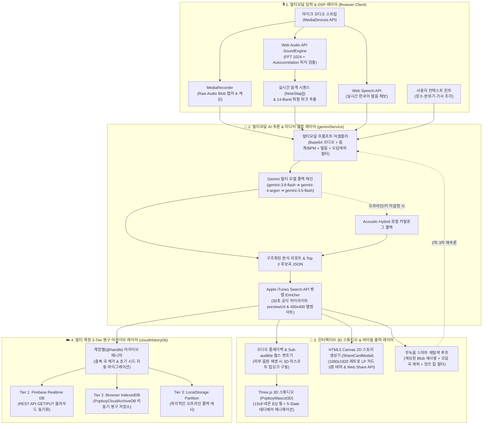

# 🧸 Hummit (허밋) — AI Humming Music Detective Studio

> **"카페에서 듣고 좋았던 그 노래, 집에 와서 '흥얼거림'만으로 찾다"**  
> 가사가 기억나지 않아도, 원곡 녹음을 놓쳤어도 괜찮습니다. 기억 속 멜로디를 어설프게 흥얼거리면 **실시간 음정(Pitch) 추출**과 **Google Gemini 멀티모달 AI**가 K-POP, J-POP, 글로벌 팝송 중 가장 일치하는 곡을 찾아 **30초 공식 원곡 하이라이트**로 즉시 들려주는 AI 음악 탐정 스튜디오입니다.

---

## 💡 기획 배경 (Problem & Solution)

- **Pain Point**: 카페나 편집샵, LP 바에서 좋은 노래가 흘러나와 음악 검색 앱(Shazam 등)을 켜려던 순간 노래가 끝나버리거나, 집에 돌아와서야 머릿속에 맴도는 멜로디(*"음~ 따라라라~"*)를 찾고 싶을 때 기존 음원 매칭 서비스로는 찾을 방법이 없었습니다.
- **Solution**: **Hummit(허밋)**은 원곡 음원 대신 **사용자의 육성 흥얼거림 오디오**, **실시간 추출된 음계 윤곽(Pitch Contour) 및 템포(BPM)**, **발음 채보**, 그리고 **기억나는 분위기/장소 힌트**를 멀티모달 AI로 종합 추론하여 높은 정확도로 노래를 찾아냅니다.

---

## ✨ 핵심 기능 (Key Features)

### 1. 🎙️ 실시간 허밍 녹음 & 라이브 피치(Autocorrelation)·발음 분석
- **Web Audio API 자기상관(Autocorrelation) 피치 트래킹**: 마이크로 입력되는 음성(75Hz~1400Hz)에서 220ms 주기로 실시간 음계(`E4 -> G4 -> A4`)와 길이, 추정 BPM, 14-밴드 오디오 파형 피크를 추출합니다.
- **실시간 한국어 발음 채보**: `Web Speech API`를 연동하여 가사를 몰라 웅얼거리는 발음 조각과 사용자가 입력한 상황 힌트(예: *"카페에서 들은 시티팝"*)를 동시에 캡처합니다.
- **센스 있는 허밍 진단 리포트**: 음정 정확도, 리듬 안정성 수치와 함께 `'인간 축음기 💿'`, `'리듬 천재 그루브 🕺'`, `'영혼을 갈아넣은 추임새 🔥'`, `'음정 파괴 아티스트 ⚡'` 등 유쾌한 진단 코멘트를 제공합니다.

### 2. 🧠 Gemini 멀티모달 추론 & 무녹음 스마트 재탐색 (Zero Re-recording Retry)
- **3단계 추론 근거 제시**: 단순 곡 나열이 아니라 **① 멜로디 윤곽 일치 이유**, **② 리듬/그루브 일치 이유**, **③ 발음·보컬 무드 단서**와 함께 Top 3 후보곡을 추천합니다.
- **다시 부르지 않아도 되는 재탐색 루프**: 후보 3곡 중 찾는 노래가 없다면, 메모리에 캐싱된 내 녹음 원본과 음계를 그대로 활용해 **이전 오답 곡들을 자동 제외(`excludedTitles`)**하고 장르 칩(`🇯🇵 J-POP/시티팝`, `🇰🇷 K-POP/인디`, `🌎 팝송/R&B`, `🎸 밴드/록`)이나 추가 힌트를 적용해 즉시 새로운 후보 3곡을 재추론합니다.

### 3. 💿 원곡 30초 공식 하이라이트 미리듣기 & 내 목소리 다시 듣기
- **Apple iTunes Search API 실시간 연동**: 추천된 후보곡들과 오늘의 허밍 트렌드 차트 곡들에 대해 **원곡 가수의 공식 30초 하이라이트 음원(`previewUrl`)**과 고화질 앨범 커버(`400x400bb`)를 즉시 스트리밍합니다.
- **내 흥얼거림 녹음 원본 다시 듣기**: 내가 방금 부른 흥얼거림 음성을 그대로 다시 재생해 원곡 하이라이트와 비교해 볼 수 있습니다.

### 4. 🧸 Three.js 3D 코지 스튜디오 마스코트 & 1080×1920 LP 공유 카드
- **실시간 주파수 반응형 3D 스튜디오 (`PopboyMascot3D`)**: 13열×9단 골든 네온 이퀄라이저 월, 빈티지 턴테이블, 아날로그 신디사이저 데스크가 있는 3D 골방 스튜디오에서 테디베어 마스코트가 5가지 상태(`idle`, `listening`, `thinking`, `singing`, `celebrating`)와 실시간 오디오 주파수에 맞춰 입을 움직이고 리듬을 탑니다.
- **인스타그램 스토리 맞춤형 LP 카드 생성기 (`ShareCardModal`)**: HTML5 Canvas 2D API를 통해 3가지 테마(`HUMMIT STUDIO`, `AURA CHROME`, `ACID Y2K`)의 **1080×1920px 고해상도 레트로 LP 카드**를 즉시 렌더링하며, PNG 다운로드 및 모바일 네이티브 공유(`navigator.share`)를 지원합니다.

### 5. ☁️ 계정별 3-Tier 클라우드 LP 보관함 (Multi-Account Cloud DB)
- 계정 핸들(`@huiju`, `@popboymp3`, `@cafe_digger` 및 새 계정 생성)별로 찾은 노래와 당시 흥얼거린 메모를 독립 보관합니다.
- `Firebase Realtime Database REST API` ↔ `IndexedDB` ↔ `LocalStorage` 3단계 하이브리드 동기화로 새로고침이나 오프라인 환경에서도 안전하게 아카이브를 유지합니다.

---

## 🏗️ 시스템 아키텍처 및 기술 스택 (System Architecture & Tech Stack)



### 🛠️ Tech Stack 상세

| 구분 | 기술 스택 | 상세 적용 내용 |
| :--- | :--- | :--- |
| **Frontend** | **React 19**, **TypeScript 5.7**, **Vite 6.2**, **Tailwind CSS 3.4** | 다크 스튜디오 감성(`#121216` & `#F5B041`) 반응형 UI, 사이드바/글로벌 미니 플레이어 아키텍처 |
| **AI & Inference** | **Google GenAI SDK (`@google/genai`)** | 오디오 바이너리(`inlineData`) + 음계 시퀀스 + 발음/힌트 멀티모달 추론, 멀티 모델 폴백 체인 |
| **Audio & DSP** | **Web Audio API**, **MediaRecorder**, **Web Speech API** | 시간 영역 자기상관(Autocorrelation) 피치 검출기, 3-오실레이터 폴리포닉 신디사이저, 서브오더블 립싱크 펄스 변조 |
| **3D & Graphics** | **Three.js (`^0.174.0`)**, **HTML5 Canvas 2D**, **Canvas Confetti** | ACES Filmic 톤 매핑 기반 3D 골방 스튜디오 및 13×9 네온 EQ 월, 1080×1920px 스토리 공유 카드 렌더링 |
| **External API & DB** | **Apple iTunes Search API**, **IndexedDB**, **Firebase RTDB** | 무인증 30초 공식 하이라이트 음원/고화질 커버 패칭, 3-Tier(Firebase REST + IndexedDB + LocalStorage) 아카이브 |

---

## 📂 디렉토리 구조 (Project Structure)

```text
popboy-ai/
├── index.html                  # Pretendard / Outfit / JetBrains Mono 폰트 및 다크 스튜디오 베이스
├── package.json                # React 19, Three.js, @google/genai, Tailwind 설정
├── vercel.json                 # Vercel SPA 배포 설정
└── src/
    ├── main.tsx                # 엔트리 포인트
    ├── App.tsx                 # 메인 스튜디오 레이아웃, 허밍 녹음, 재탐색 루프, 글로벌 플레이어
    ├── types.ts                # SongCandidate, AnalysisResult, UserAccount 등 데이터 스키마
    ├── index.css               # 스튜디오 앰비언트 글로우 오브 & 글래스모피즘 스타일
    ├── components/
    │   ├── PopboyMascot3D.tsx  # Three.js 3D 테디베어 마스코트 & 13x9 골든 네온 EQ 스튜디오 룸
    │   └── ShareCardModal.tsx  # HTML5 Canvas 기반 1080x1920 인스타 스토리 LP 카드 생성기
    └── services/
        ├── geminiService.ts    # Gemini 멀티모달 추론 엔진, 멀티 모델 폴백 & iTunes API Enricher
        ├── synthService.ts     # Web Audio 자기상관 피치 검출, 립싱크 펄스 변조, 신디사이저 엔진
        └── cloudHistoryDb.ts   # 계정별 Firebase RTDB REST + IndexedDB + LocalStorage 3-Tier DB
```

---

## 🚀 실행 방법 (Getting Started)

```bash
# 1. 의존성 패키지 설치
npm install

# 2. 환경 변수 설정 (.env 파일 생성)
cp .env.example .env
# .env 파일 내 VITE_GEMINI_API_KEY에 Gemini API 키 입력
# (또는 웹 앱 실행 후 우측 상단 🔑 열쇠 아이콘 모달에서 즉시 입력 가능)

# 3. 개발 서버 실행
npm run dev

# 4. 프로덕션 빌드
npm run build
```
